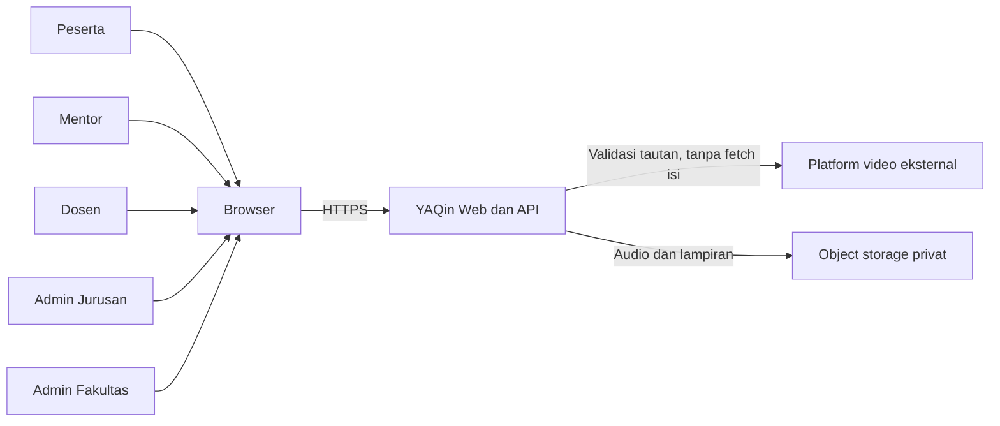
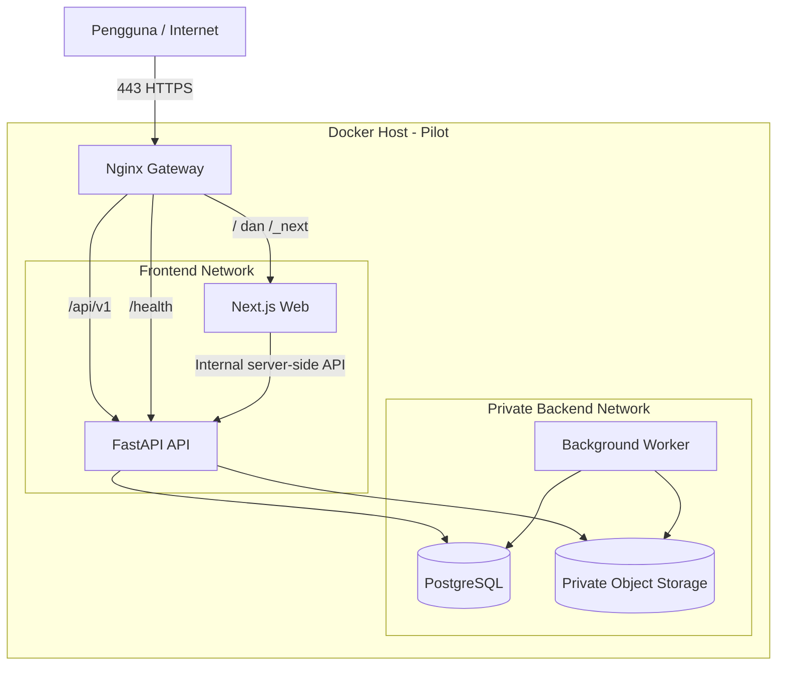
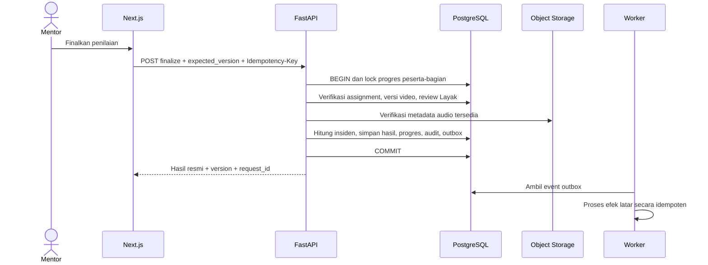

# Arsitektur Teknis YAQin

## FastAPI, Next.js, PostgreSQL, dan Docker

| Atribut | Nilai |
|---|---|
| Produk | YAQin - Aplikasi Pendampingan Hafalan Juz 30 |
| Dokumen | Arsitektur aplikasi dan deployment |
| Versi | 1.0 |
| Tanggal | 20 Oktober 2026 |
| Status | Baseline implementasi untuk ditinjau |
| Backend | FastAPI |
| Frontend | Next.js |
| Database | PostgreSQL |
| Runtime | Container Docker |
| Deployment pilot | Docker Compose pada satu host, dengan komponen terpisah |
| Dokumen terkait | `docs/PRD-Aplikasi-Tahfidz-YAQin.md`, `docs/database.md` |

> Dokumen ini mengonkretkan rancangan YAQin menjadi arsitektur implementasi. Aturan akademik yang belum disahkan tetap menjadi keputusan terbuka dan tidak boleh digantikan oleh nilai bawaan aplikasi.

---

## 1. Ringkasan Keputusan Arsitektur

YAQin dibangun sebagai modular monolith dengan pemisahan tegas antara antarmuka, API, aturan domain, penyimpanan data, media privat, dan pekerjaan latar.

Keputusan utamanya:

1. Next.js melayani antarmuka web responsif untuk lima peran.
2. FastAPI menyediakan API JSON berversi pada `/api/v1` dan menjadi satu-satunya tempat aturan akademik dijalankan.
3. PostgreSQL menjadi sumber kebenaran untuk data operasional, hasil akademik, audit, idempotensi, dan transactional outbox.
4. Audio Mentor dan lampiran disimpan di object storage privat. Video MVP tetap berupa tautan eksternal yang divalidasi.
5. Worker terpisah memproses outbox, ekspor, notifikasi, validasi media, dan pekerjaan tertunda.
6. Nginx menjadi satu pintu masuk HTTPS dan reverse proxy untuk Next.js serta FastAPI.
7. Seluruh komponen dijalankan dalam container Docker. Docker Compose digunakan untuk development, staging, dan pilot satu host.
8. Hanya gateway yang membuka port publik. API, PostgreSQL, worker, dan object storage berada di jaringan privat Docker.
9. Autentikasi web menggunakan session cookie `Secure`, `HttpOnly`, dan `SameSite`, dengan proteksi CSRF.
10. Finalisasi akademik menggunakan transaksi PostgreSQL, row lock, optimistic version, unique constraint, dan Idempotency-Key.

## 2. Sasaran Arsitektur

### 2.1 Sasaran utama

- Mendukung alur akun, kurikulum, setoran tema, video, ujian, nilai, audit, dan laporan.
- Menjaga konsistensi hasil akademik pada klik ganda, retry, koneksi putus, dan finalisasi bersamaan.
- Membatasi akses berdasarkan peran, organisasi, kepemilikan, penugasan, masa berlaku, dan status objek.
- Menjaga hasil final dan perubahan sebagai riwayat yang dapat ditelusuri.
- Menggunakan satu API yang kelak dapat dipakai oleh aplikasi Android.
- Menyediakan deployment pilot yang sederhana untuk dioperasikan dan dipulihkan.
- Memungkinkan penskalaan web, API, dan worker tanpa memecah domain menjadi microservices terlalu dini.

### 2.2 Batas arsitektur MVP

- Tidak ada video call internal.
- Tidak ada aplikasi Android pada tahap pilot.
- Tidak ada penilaian AI pada MVP.
- Tidak ada sinkronisasi finalisasi akademik secara offline.
- Tidak ada penyimpanan video sebagai blob pada PostgreSQL.
- Tidak ada event broker tambahan pada tahap awal; PostgreSQL transactional outbox cukup untuk pilot.
- Tidak ada microservices per domain sebelum kebutuhan skala dan batas organisasi terbukti.

## 3. Architectural Drivers

| Driver | Konsekuensi arsitektur |
|---|---|
| Hasil akademik tidak boleh ganda | Idempotensi, row lock, unique constraint, dan transaksi atomik |
| Lima peran dengan lingkup berbeda | Otorisasi per objek pada service FastAPI |
| Aturan akademik berversi | `policy_versions`, snapshot, audit, dan rule service |
| Web lebih dulu, Android kemudian | API JSON `/api/v1` tidak bergantung pada Next.js |
| Audio privat | Object storage privat dan signed URL berumur pendek |
| Video MVP berupa tautan | Validasi HTTPS/allowlist tanpa server fetch sembarang URL |
| PWA-ready tetapi bukan offline penuh | Cache hanya aset publik; data identitas/nilai/media tidak masuk public cache |
| Pilot skala terbatas | Docker Compose satu host dan modular monolith |
| Pemulihan harus dibuktikan | Backup database/media, restore drill, runbook, dan monitoring |
| Aturan M/D belum final | Komponen nilai nullable; fitur publikasi dibatasi feature flag/policy gate |

## 4. Stack Teknologi

| Lapisan | Teknologi | Keputusan |
|---|---|---|
| Frontend | Next.js App Router, React, TypeScript | Server-rendered shell, Server Components untuk baca, Client Components untuk interaksi |
| UI | CSS Modules/Tailwind atau design system yang disepakati | Satu sistem komponen aksesibel; keputusan final saat fondasi UI |
| API | FastAPI, Pydantic | OpenAPI otomatis, validasi request/response, dependency injection |
| Application/domain | Python modules | Use case dan aturan bisnis tidak diletakkan di route handler |
| ORM | SQLAlchemy 2.x | Unit of Work, transaksi eksplisit, mapping relasional |
| Migration | Alembic | Migration maju-kompatibel dan terversi |
| Driver PostgreSQL | Psycopg 3 | Pool koneksi dan dukungan transaksi PostgreSQL |
| Database | PostgreSQL 18 atau major aktif yang disetujui operasi | Satu database relasional privat |
| Worker | Image FastAPI yang sama dengan command worker berbeda | Transactional outbox, ekspor, notifikasi, media |
| Object storage | S3-compatible private storage | Audio/lampiran; MinIO boleh digunakan pada lokal/staging jika disetujui |
| Gateway | Nginx | TLS termination, routing, header proxy, batas request |
| Container | Docker, Docker Compose | Build reproducible, health check, jaringan privat |
| Observability | Structured JSON logs, metrics, traces | `request_id` menghubungkan web, API, worker, dan audit |
| Testing | Pytest, Vitest/Jest, Playwright | Unit, integrasi, kontrak, E2E, aksesibilitas |

Versi minor dan digest image dipilih saat kickoff, dikunci pada lockfile/manifest, dan diperbarui melalui pull request teruji. Jangan memakai tag image `latest` pada staging atau produksi.

## 5. Konteks Sistem



Batas sistem:

- Tatap muka dan video call berlangsung di luar aplikasi.
- YAQin menyimpan pengajuan, jadwal, bukti, penilaian, progres, dan hasil.
- Platform video eksternal tidak dipercaya sebagai sumber otorisasi.
- Object storage tidak dapat diakses publik tanpa URL bertanda tangan.

## 6. Arsitektur Container



### 6.1 Daftar service Docker

| Service | Image | Port internal | Port publik | Tanggung jawab |
|---|---|---:|---:|---|
| `gateway` | Nginx unprivileged, versi/digest terkunci | 8080/8443 | 80/443 | TLS, routing, security headers, request limits |
| `web` | Image Next.js standalone | 3000 | Tidak ada | UI, SSR, route rendering, static assets |
| `api` | Image Python/FastAPI | 8000 | Tidak ada | API, autentikasi, otorisasi, domain, transaksi |
| `worker` | Image backend yang sama | N/A | Tidak ada | Outbox, media, ekspor, notifikasi, pekerjaan tertunda |
| `db` | PostgreSQL | 5432 | Tidak ada | Data relasional, audit, transaksi, outbox |
| `object-storage` | S3-compatible | 9000 | Tidak ada | Audio/lampiran privat |
| `backup` | Image/tool operasi terpisah | N/A | Tidak ada | Backup terjadwal dan verifikasi; opsional sebagai service Compose |

Console object storage, PostgreSQL, dan dokumentasi API tidak dibuka ke internet. Akses administratif hanya melalui jaringan operasi yang dilindungi, tunnel, atau SSH sesuai kebijakan institusi.

## 7. Routing dan Satu Origin

Gunakan satu origin, misalnya `https://tahfidz.example.ac.id`.

| Path | Tujuan |
|---|---|
| `/` | Next.js |
| `/_next/*` | Aset Next.js |
| `/api/v1/*` | FastAPI |
| `/api/docs` | Dokumentasi API, hanya development/staging atau akses admin |
| `/health/live` | Liveness API |
| `/health/ready` | Readiness API |

Manfaat satu origin:

- Session cookie tidak memerlukan konfigurasi cross-origin.
- Risiko CORS berkurang.
- Proteksi CSRF dan kebijakan cookie lebih sederhana.
- Browser dan Next.js server menggunakan kontrak API yang sama.

Nginx meneruskan `X-Forwarded-For`, `X-Forwarded-Proto`, dan host secara benar. FastAPI dijalankan dengan dukungan proxy headers hanya karena gateway yang dipercaya berada di depannya.

## 8. Arsitektur Frontend Next.js

### 8.1 Tanggung jawab

- Menyajikan 20 layar G01, P01-P06, M01-M05, D01-D04, J01-J03, dan F01.
- Menampilkan data resmi dari API.
- Melakukan validasi UX awal tanpa menjadi sumber aturan akademik.
- Menangani status loading, kosong, berhasil, gagal, konflik, dan belum tersimpan.
- Menjaga aksesibilitas, responsivitas, dan Bahasa Indonesia.

### 8.2 App Router

Gunakan App Router dengan segmentasi berdasarkan area/peran:

```text
apps/web/src/app/
  (public)/
    login/
    recovery/
  (authenticated)/
    participant/
    mentor/
    lecturer/
    department-admin/
    faculty-admin/
  error.tsx
  loading.tsx
  not-found.tsx
  layout.tsx
```

Prinsip:

- Server Components digunakan untuk pembacaan awal dan halaman yang tidak memerlukan state browser.
- Client Components digunakan untuk form interaktif, audio, dialog, filter lokal, dan optimistic UI terbatas.
- Server Actions tidak memuat aturan akademik. Jika digunakan, fungsinya hanya meneruskan command ke FastAPI dengan konteks sesi yang sah.
- Status resmi selalu dibaca ulang dari API setelah command finalisasi.

### 8.3 API client

- OpenAPI FastAPI menjadi sumber kontrak.
- Client TypeScript dihasilkan otomatis dari OpenAPI pada CI.
- Generated client tidak diedit manual.
- Error API dipetakan ke model UI yang konsisten: `code`, `message`, `field_errors`, dan `request_id`.
- `409` memicu reload data dan peninjauan ulang, bukan overwrite otomatis.

### 8.4 State dan cache

- Data identitas, nilai, media, penilaian, dan antrean menggunakan `no-store` atau strategi revalidation eksplisit.
- Jangan menaruh data sensitif dalam localStorage.
- State form sementara boleh berada di memori browser.
- Draft server disimpan melalui API dan memiliki `row_version`.
- Cache publik hanya untuk aset build dan materi publik yang telah disetujui.

### 8.5 PWA-ready

- Manifest, icon, dan installability dapat disiapkan.
- Service worker hanya meng-cache app shell/aset publik yang aman.
- Respons API terautentikasi, identitas, nilai, signed URL, dan media tidak masuk public cache.
- Finalisasi membutuhkan konfirmasi server; UI tidak boleh menampilkan berhasil sebelum respons resmi.

### 8.6 Build container

Next.js dikonfigurasi dengan `output: "standalone"` dan dibangun menggunakan multi-stage Dockerfile:

1. `deps`: memasang dependensi dari lockfile.
2. `builder`: menjalankan type check, test yang diperlukan, dan `next build`.
3. `runner`: menyalin output standalone, aset statis, dan public assets.
4. Menjalankan proses sebagai user non-root.
5. Image runtime tidak membawa source, package manager cache, atau dev dependencies yang tidak diperlukan.

## 9. Arsitektur Backend FastAPI

### 9.1 Lapisan backend

```text
HTTP Router
  -> Application Use Case
    -> Domain Rules / Policy Service
      -> Repository / Unit of Work
        -> PostgreSQL / Object Storage / Outbox
```

Tanggung jawab:

| Lapisan | Tanggung jawab |
|---|---|
| Router | Parsing request, dependency auth, response model, HTTP status |
| Application | Orkestrasi use case, transaksi, idempotensi, audit |
| Domain | Aturan akademik, prasyarat, kalkulasi, state transition |
| Repository | Query/mutation data dan lock yang diperlukan |
| Infrastructure | PostgreSQL, object storage, hash, session, telemetry |

Route handler tidak boleh menghitung kelulusan, nomor kesempatan, revisi, atau status progres secara langsung.

### 9.2 Struktur modul

```text
apps/api/app/
  main.py
  api/
    dependencies.py
    errors.py
    v1/
  core/
    config.py
    security.py
    logging.py
    telemetry.py
  modules/
    identity/
    organizations/
    cohorts/
    curriculum/
    calendar/
    mentoring/
    video/
    media/
    exams/
    grading/
    corrections/
    reporting/
    audit/
  db/
    base.py
    session.py
    models/
    migrations/
  worker/
    main.py
    handlers/
  tests/
```

Setiap domain module memiliki model, schema, repository, service/use case, dan test. Ketergantungan antarmodul dilakukan melalui interface/use case, bukan import model bebas ke seluruh aplikasi.

### 9.3 FastAPI process model

- Image dibangun dari official Python slim image, bukan image FastAPI/Gunicorn lama.
- Gunakan exec-form command agar graceful shutdown dan lifespan berjalan benar.
- Pada Compose pilot, mulai dari satu process API per container.
- Replikasi dilakukan dengan menambah container `api` setelah metrik menunjukkan kebutuhan.
- Jika satu container harus memakai beberapa worker, gunakan opsi worker yang didukung server FastAPI/Uvicorn dan ukur koneksi database per worker.
- Migration tidak dijalankan bersamaan oleh semua replica; gunakan job/command deployment terpisah.

### 9.4 OpenAPI

- Prefix API: `/api/v1`.
- OpenAPI JSON diterbitkan pada staging dan dipakai menghasilkan client TypeScript.
- Endpoint dokumentasi dimatikan atau dibatasi pada production.
- Breaking change membutuhkan `/api/v2` atau masa kompatibilitas yang disepakati.

## 10. Modul Domain

| Modul | Tanggung jawab utama |
|---|---|
| Identity | Login, logout, pemulihan, session, status akun |
| Organizations | Fakultas, jurusan, role grants, lingkup |
| Cohorts | Angkatan, kepesertaan, penugasan Mentor/Dosen |
| Curriculum | Versi kurikulum, lima bagian, 44 tema, rentang ayat |
| Calendar | 52 pekan, target, tenggat, perubahan tenggat, skor K |
| Mentoring | Pengajuan sesi, jadwal, actual session, tema, kesempatan 1-5 |
| Video | Slot akademik, versi media, kelayakan, penilaian video |
| Media | Upload audio, metadata, validasi, signed URL |
| Exams | Bank soal berversi, paket, pelaksanaan, penilaian Dosen |
| Grading | Sumber K/M/D, snapshot N, kesiapan, kelulusan |
| Corrections | Permintaan, pengesahan, record pengganti, dampak progres |
| Reporting | Antrean, progres, agregat sesuai lingkup, ekspor |
| Audit | Perubahan penting, request_id, actor, before/after aman |

## 11. Arsitektur Data PostgreSQL

PostgreSQL menyimpan 32 entitas domain yang dirinci pada `docs/database.md` dan beberapa tabel teknis.

### 11.1 Schema database

Rekomendasi:

| Schema | Isi |
|---|---|
| `app` | 32 tabel domain YAQin |
| `ops` | `api_idempotency`, `outbox_events`, `job_runs`, dan data operasi |
| `alembic` | Version table migration, atau gunakan schema default Alembic |

Jika tim memilih satu schema untuk kesederhanaan, prefix/nama tabel teknis tetap harus membedakannya dari domain.

### 11.2 Koneksi

- FastAPI dan worker menggunakan role database berbeda bila operasi memungkinkan.
- Migration memakai role khusus dengan hak DDL.
- Runtime API tidak memiliki hak membuat/menghapus schema.
- Pool koneksi dihitung dari jumlah container x worker x pool size dan harus berada di bawah `max_connections` dengan ruang untuk operasi/backup.
- Statement timeout dan idle-in-transaction timeout diatur untuk mencegah transaksi menggantung.

### 11.3 Transaksi

- Default transaksi menggunakan Read Committed dengan row lock eksplisit pada agregat/progres yang dialokasikan.
- Lock diambil dalam urutan konsisten untuk mengurangi deadlock.
- Transaksi tidak menunggu input pengguna atau pekerjaan jaringan eksternal.
- Deadlock dan serialization failure yang aman di-retry dengan batas serta jitter.
- Finalisasi menyimpan hasil, progres, audit, dan outbox dalam satu transaksi.

### 11.4 Migration

- Alembic revision menjadi bagian dari artefak rilis.
- Setiap perubahan model memiliki migration dan test upgrade dari versi produksi sebelumnya.
- Gunakan pola expand-migrate-contract:
  1. Tambah struktur baru yang kompatibel.
  2. Deploy kode yang dapat membaca format lama/baru.
  3. Migrasikan/backfill data.
  4. Alihkan pembacaan penuh.
  5. Hapus struktur lama pada rilis berikutnya setelah verifikasi.
- Migration destruktif membutuhkan backup dan rencana pemulihan yang diuji.

## 12. Autentikasi dan Session

### 12.1 Web

- Session disimpan server-side atau sebagai opaque session ID yang menunjuk record server.
- Cookie: `Secure`, `HttpOnly`, `SameSite=Lax` atau lebih ketat sesuai alur, path yang sesuai, dan masa hidup terbatas.
- Rotasi session ID setelah login dan perubahan hak penting.
- Logout dan penonaktifan akun mencabut session aktif.
- Perubahan penugasan berlaku pada request berikutnya.
- Perubahan data memakai token CSRF yang divalidasi server.

### 12.2 Password dan pemulihan

- Password di-hash dengan algoritme modern yang dikelola pustaka terpelihara.
- Token pemulihan sekali pakai, berumur pendek, dan disimpan dalam bentuk hash.
- Respons login/pemulihan tidak membocorkan keberadaan akun.
- Rate limit diterapkan pada login, pemulihan, dan endpoint sensitif.

### 12.3 Android mendatang

Mekanisme token Android tidak diimplementasikan pada MVP. API domain dipertahankan independen dari session web agar OAuth/OIDC atau token perangkat dapat ditambahkan pada tahap Android tanpa mengganti aturan bisnis.

## 13. Otorisasi per Objek

FastAPI wajib memeriksa seluruh dimensi berikut:

1. User aktif.
2. Role grant aktif.
3. Organisasi sesuai.
4. Kepemilikan peserta atau assignment aktif.
5. Masa berlaku penugasan.
6. Status objek memungkinkan tindakan.
7. Policy version dan prasyarat akademik sesuai.
8. Command belum difinalkan atau dikoreksi oleh versi yang lebih baru.

Pemeriksaan hanya pada menu Next.js tidak cukup. ID UUID yang sulit ditebak juga bukan kontrol akses.

## 14. Kontrak API

### 14.1 Bentuk respons

Respons berhasil:

```json
{
  "data": {},
  "version": 7,
  "request_id": "uuid"
}
```

Respons gagal:

```json
{
  "code": "ASSESSMENT_VERSION_CONFLICT",
  "message": "Data telah berubah. Muat ulang sebelum memfinalkan.",
  "field_errors": {},
  "request_id": "uuid"
}
```

### 14.2 Status HTTP

| Status | Pemakaian |
|---:|---|
| 200/201 | Berhasil |
| 401 | Session tidak sah |
| 403 | Aktor tidak berwenang |
| 404 | Objek tidak tersedia dalam lingkup |
| 409 | Konflik versi, status, atau prasyarat |
| 422 | Isian tidak valid |
| 429 | Rate limit |

### 14.3 Endpoint awal

| Operasi | Endpoint |
|---|---|
| Baca target sendiri | `GET /api/v1/me/targets` |
| Ajukan sesi | `POST /api/v1/sessions` |
| Finalkan tema | `POST /api/v1/theme-assessments/{id}/finalize` |
| Kirim versi video | `POST /api/v1/video-attempts/{id}/versions` |
| Finalkan kelayakan | `POST /api/v1/video-versions/{id}/eligibility` |
| Finalkan nilai video | `POST /api/v1/video-assessments/{id}/finalize` |
| Buat ujian | `POST /api/v1/exams` |
| Finalkan ujian | `POST /api/v1/exams/{id}/finalize` |
| Baca rekap | `GET /api/v1/enrollments/{id}/grades` |
| Ajukan koreksi | `POST /api/v1/corrections` |

Endpoint daftar menggunakan cursor pagination atau pagination stabil, filter server-side, dan scope authorization sebelum query dikembalikan.

## 15. Idempotensi dan Optimistic Concurrency

Command kritis membawa:

- Header `Idempotency-Key`.
- Field `expected_version`.
- Actor/session context.

Tabel teknis `ops.api_idempotency` menyimpan:

- actor ID;
- method dan normalized path;
- idempotency key;
- request hash;
- status proses;
- response status/body yang aman;
- waktu kedaluwarsa.

Aturan:

- Request identik dengan kunci sama mengembalikan hasil sebelumnya.
- Kunci sama dengan payload berbeda ditolak.
- Unique constraint tetap menjadi pertahanan terakhir.
- Timeout jaringan tidak dianggap gagal; klien mengulangi dengan kunci sama atau membaca status resmi.

## 16. Transactional Outbox dan Worker

### 16.1 Alasan

Finalisasi akademik tidak boleh gagal hanya karena ekspor, notifikasi, atau pekerjaan media gagal. Karena itu transaksi utama hanya menulis event ke outbox. Worker memprosesnya setelah commit.

### 16.2 Tabel teknis outbox

Field minimum:

- `id`
- `event_type`
- `aggregate_type`
- `aggregate_id`
- `payload`
- `created_at`
- `available_at`
- `processed_at`
- `attempt_count`
- `last_error`
- `locked_at`
- `locked_by`

Worker mengambil batch menggunakan `FOR UPDATE SKIP LOCKED`, memproses secara idempoten, lalu menandai event selesai. Dead letter policy diterapkan setelah batas retry.

### 16.3 Pekerjaan worker

- Validasi pasca-upload audio.
- Pengiriman notifikasi/pengingat setelah fitur P1 aktif.
- Pembuatan ekspor laporan.
- Pemeliharaan projection/materialized view bila dipakai.
- Cleanup session/token kedaluwarsa.
- Rekonsiliasi media dan metadata.
- Pekerjaan terjadwal yang tidak mengubah hasil akademik tanpa command sah.

Redis/Celery tidak diperlukan pada pilot. Tambahkan message broker hanya bila throughput, penjadwalan, atau isolasi workload sudah terbukti membutuhkannya.

## 17. Alur Finalisasi Penilaian Video



Object storage tidak dipanggil di tengah transaksi untuk operasi lambat. Status media sudah harus `available` di PostgreSQL sebelum finalisasi; jika perlu pengecekan tambahan, lakukan sebelum transaksi atau melalui worker.

## 18. Arsitektur Media

### 18.1 Audio Mentor

Alur yang direkomendasikan:

1. Web meminta izin upload kepada API.
2. API memeriksa actor, peserta, draft penilaian, jenis, dan batas ukuran.
3. API membuat `media_assets` berstatus `uploading` dan signed upload URL.
4. Browser mengunggah langsung ke object storage privat.
5. Web memberi tahu API bahwa upload selesai.
6. Worker memeriksa ukuran, MIME, checksum, dan status object.
7. API/worker mengubah media menjadi `available` atau `failed/quarantined`.
8. Finalisasi hanya menerima media `available` milik konteks yang sah.

### 18.2 Pemutaran

- Browser meminta akses ke API.
- API memeriksa izin per objek.
- API mengembalikan signed URL berumur pendek.
- Signed URL tidak dicatat di log umum atau cache publik.
- Audio tidak diputar otomatis.

### 18.3 Video

- MVP menyimpan tautan HTTPS dan metadata, bukan isi video.
- Host harus masuk allowlist yang disetujui.
- Backend tidak melakukan server-side fetch ke URL pengguna.
- Penolakan teknis membuat versi media baru pada attempt yang sama.
- Kebijakan akses, retensi, dan privasi platform eksternal harus ditetapkan sebelum pilot.

## 19. Docker Image Design

### 19.1 Image FastAPI

- Base image official Python slim dengan versi dan digest terkunci.
- Dependency dikunci dengan `uv.lock` atau mekanisme lock setara.
- Multi-stage build bila compiler/build dependency diperlukan.
- Salin dependency metadata sebelum source agar cache build efektif.
- Jalankan sebagai non-root.
- Gunakan exec-form `CMD`.
- Jangan masukkan `.env`, test fixture sensitif, cache, atau credential.
- API dan worker menggunakan image yang sama dengan command berbeda.

Command konseptual:

```text
api:    fastapi run app/main.py --host 0.0.0.0 --port 8000 --proxy-headers
worker: python -m app.worker.main
```

### 19.2 Image Next.js

- Node LTS official slim/alpine yang kompatibel, dipilih dan diuji.
- `pnpm-lock.yaml` atau lockfile lain wajib.
- Build dengan `output: "standalone"`.
- Runner hanya membawa output yang diperlukan.
- Jalankan sebagai non-root.
- Environment yang memengaruhi bundle publik dipisahkan dari secret runtime.

### 19.3 Image PostgreSQL

- Gunakan official PostgreSQL image dengan major/minor yang disetujui.
- Data berada pada named volume atau storage persisten host yang dikelola.
- Konfigurasi, user, database, dan password diberikan melalui secret/env runtime.
- Jangan bake data atau credential ke image.

## 20. Docker Compose

### 20.1 File Compose

Struktur yang direkomendasikan:

```text
infra/compose/
  compose.yaml
  compose.dev.yaml
  compose.staging.yaml
  compose.prod.yaml
  nginx/
  scripts/
```

`compose.yaml` menjadi baseline. File environment menambahkan override, bukan menyalin seluruh definisi.

### 20.2 Dependency dan health check

- `db` memiliki health check `pg_isready`.
- `object-storage` memiliki health endpoint.
- `api` readiness memeriksa koneksi database dan migration compatibility, bukan melakukan query mahal.
- `worker` readiness menunjukkan loop worker aktif dan koneksi database tersedia.
- `web` health check memastikan Next.js dapat merespons.
- `gateway` mulai setelah upstream siap atau memiliki retry yang benar.
- Gunakan `depends_on` dengan kondisi sehat untuk startup Compose, tetapi aplikasi tetap harus tahan terhadap dependency yang restart setelah startup.

### 20.3 Network

```text
edge_net:
  gateway <-> web/api

backend_net (internal):
  api/worker <-> db/object-storage
```

`db` dan `object-storage` tidak bergabung ke `edge_net` kecuali ada alasan operasional yang terdokumentasi.

### 20.4 Volume

- `postgres_data`: persisten dan dibackup.
- `object_data`: persisten jika object storage self-hosted.
- Gateway certificate/config: read-only.
- Source code tidak di-mount pada production.
- Log aplikasi dikirim ke stdout/stderr; log collector/host menangani retensi.

## 21. Konfigurasi dan Secret

Semua konfigurasi divalidasi saat startup. Nama environment variable konseptual:

### 21.1 API

- `APP_ENV`
- `APP_VERSION`
- `DATABASE_URL`
- `DATABASE_POOL_SIZE`
- `SESSION_SECRET`
- `CSRF_SECRET`
- `ALLOWED_HOSTS`
- `TRUSTED_PROXY_COUNT` atau allowlist proxy
- `OBJECT_STORAGE_ENDPOINT`
- `OBJECT_STORAGE_BUCKET`
- `OBJECT_STORAGE_ACCESS_KEY`
- `OBJECT_STORAGE_SECRET_KEY`
- `SIGNED_URL_TTL_SECONDS`
- `VIDEO_ALLOWED_HOSTS`
- `LOG_LEVEL`

### 21.2 Web

- `INTERNAL_API_BASE_URL`
- `NEXT_PUBLIC_APP_NAME`
- `NEXT_PUBLIC_BASE_URL`
- `NEXT_TELEMETRY_DISABLED` bila kebijakan mengharuskan

Secret tidak memakai prefix `NEXT_PUBLIC_`. Secret production disediakan melalui secret manager atau mekanisme Docker secret yang disetujui, bukan file `.env` dalam repository.

## 22. Lingkungan

| Lingkungan | Data | Tujuan | Catatan |
|---|---|---|---|
| Development | Data dummy lokal | Pengembangan harian | Hot reload boleh; port lokal dapat dibuka |
| Test/CI | Data disposable | Unit/integrasi/E2E | Database dibuat ulang per job atau suite |
| Staging | Data sintetis menyerupai pilot | UAT, beban, migration, restore | Integrasi pesan diarahkan ke sink uji |
| Pilot production | Data nyata terbatas | Pilot satu jurusan | Akses ketat, backup, monitoring, runbook |

Data production tidak disalin ke development. Jika diperlukan untuk debugging, gunakan dataset yang sudah dianonimkan dan proses persetujuan.

## 23. Deployment Pilot

### 23.1 Topologi

- Satu VM/server Linux yang mendukung Docker Engine dan Compose.
- Hanya 80/443 dari gateway yang dibuka publik.
- SSH dibatasi IP/VPN dan menggunakan key.
- PostgreSQL serta object storage memakai volume persisten terpisah.
- Backup dikirim ke lokasi lain yang terenkripsi.
- DNS dan TLS dikelola sebelum pengguna nyata masuk.

### 23.2 Urutan rilis

1. Bekukan image berdasarkan commit SHA.
2. Jalankan unit, integration, E2E, security, dan image scan.
3. Deploy image ke staging.
4. Jalankan migration di staging.
5. Jalankan smoke test alur utama dan otorisasi.
6. Buat backup production.
7. Jalankan migration production yang kompatibel.
8. Deploy API/worker/web/gateway.
9. Verifikasi health, login, baca target, simpan draft, dan akses media.
10. Catat versi aplikasi, migration, policy, dan hasil pemeriksaan.

Jika pemeriksaan gagal, hentikan perluasan dan jalankan rollback aplikasi yang sudah diuji. Migration destruktif tidak boleh bergantung pada downgrade otomatis.

## 24. CI/CD

Pipeline minimum:

### 24.1 Pull request

- Format/lint Python dan TypeScript.
- Type check.
- Unit test domain.
- Test migration upgrade.
- Integration test API dan PostgreSQL.
- Generate OpenAPI dan verifikasi generated client tidak berubah tanpa commit.
- Frontend component/test.
- Build image FastAPI dan Next.js.
- Dependency dan container vulnerability scan.
- Secret scan.

### 24.2 Main/release

- Build image sekali, beri tag commit SHA dan release.
- Simpan SBOM dan provenance bila tooling mendukung.
- Push ke private registry.
- Deploy artefak yang sama ke staging lalu production; jangan rebuild dengan source berbeda.
- Approval manusia sebelum pilot production.
- Post-deploy smoke test dan pencatatan hasil.

## 25. Observability

### 25.1 Logging

Log JSON terstruktur berisi:

- timestamp;
- level;
- service;
- environment;
- app version;
- request ID;
- trace ID bila tersedia;
- actor ID yang dipseudonimkan bila diperlukan;
- route/use case;
- status/error code;
- duration.

Jangan mencatat password, cookie, token, signed URL, isi rekaman, stimulus/acuan soal privat, atau data sensitif yang tidak diperlukan.

### 25.2 Metrics

- Request rate, error rate, dan latency p50/p95/p99.
- Connection pool PostgreSQL, slow query, lock wait, deadlock.
- Finalisasi berhasil/gagal/konflik.
- Retry idempotensi.
- Panjang dan umur outbox queue.
- Upload/validasi media berhasil/gagal.
- Penggunaan object storage dan disk PostgreSQL.
- Status backup dan restore terakhir.
- Health setiap container.

### 25.3 Tracing

OpenTelemetry direkomendasikan untuk menghubungkan gateway, Next.js server, FastAPI, PostgreSQL, dan worker. Untuk pilot kecil, structured log dan metrics boleh menjadi fase pertama, tetapi `request_id` wajib sejak awal.

## 26. Keamanan

### 26.1 Network

- TLS wajib pada akses publik.
- Database dan object storage tidak membuka port publik.
- Egress worker/API dibatasi sesuai kebutuhan.
- Gateway menerapkan security headers, batas body, dan timeout.

### 26.2 Application

- Validasi input dengan Pydantic dan aturan domain.
- Output encoding pada Next.js; catatan pengguna tidak dirender sebagai HTML mentah.
- CSRF protection untuk perubahan data.
- Rate limiting pada login, recovery, export, dan endpoint berisiko.
- Content Security Policy diterapkan dan diuji.
- Signed URL singkat dan scoped.
- Akses media, ekspor, dan audit diuji lintas peserta/jurusan.

### 26.3 Supply chain

- Lockfile wajib.
- Image base dipin ke major/minor dan digest pada release.
- Scan dependency dan image.
- Update keamanan melalui PR dengan test.
- Registry private dan akses push terbatas.
- Container berjalan non-root, filesystem read-only bila memungkinkan, dan capability diminimalkan.

## 27. Backup dan Disaster Recovery

### 27.1 Baseline pilot

- Backup PostgreSQL harian dan sebelum migration.
- Backup/versi object storage.
- Salinan berada di lokasi terpisah dan terenkripsi.
- Retensi ditetapkan sebelum data nyata digunakan.
- Usulan awal: RPO 24 jam dan RTO 4 jam, menunggu pengesahan L07.

### 27.2 Restore drill

Restore dilakukan ke lingkungan terisolasi dan memeriksa:

- jumlah peserta dan penilaian;
- foreign key dan constraint;
- sampel sesi, video, ujian, nilai, koreksi, dan audit;
- akses sampel audio;
- versi kurikulum dan kebijakan;
- aplikasi dapat membaca hasil setelah restore.

Backup yang belum pernah direstore tidak dianggap bukti kesiapan.

### 27.3 PostgreSQL production

Untuk pilot kecil, dump terjadwal dapat menjadi lapisan awal. Untuk produksi yang lebih besar atau RPO lebih kecil, tambahkan base backup dan WAL archiving/PITR. Strategi final mengikuti L07, kapasitas, dan layanan hosting yang dipilih.

## 28. Performa dan Skalabilitas

### 28.1 Sasaran awal

- Profil staging: 30 sesi pengguna bersamaan selama 30 menit.
- p95 API nonmedia maksimal 2 detik.
- Kegagalan teknis di bawah 1%.
- Nol kebocoran akses dan nol hasil akademik ganda.

Angka tersebut adalah target usulan, bukan hasil uji atau SLA.

### 28.2 Urutan penskalaan

1. Ukur query dan tambah indeks berdasarkan evidence.
2. Tuning connection pool dan PostgreSQL.
3. Pisahkan workload ekspor/media ke worker.
4. Tambah replica container API/web di belakang gateway.
5. Gunakan managed PostgreSQL/object storage bila operasi self-hosted menjadi risiko.
6. Tambahkan broker/cache hanya setelah bottleneck terbukti.
7. Pecah service hanya jika batas domain, tim, atau skala benar-benar membutuhkan.

Jangan cache status akademik final pada layer yang dapat menyajikan data lama tanpa version/timestamp yang jelas.

## 29. Strategi Pengujian Arsitektur

| Lapisan | Fokus |
|---|---|
| Unit domain | Batas K, insiden, skor, prasyarat, formula, state transition |
| Repository | Query scope, FK, unique, check, lock, dan migration |
| API integration | Auth, authorization, transaksi, idempotensi, konflik versi |
| Contract | OpenAPI dan client TypeScript |
| Frontend | State, form, error, responsivitas, aksesibilitas |
| E2E | Browser -> Nginx -> Next.js/FastAPI -> PostgreSQL -> baca ulang |
| Media | Upload, status, signed URL, MIME/size, izin, expired URL |
| Security | CSRF, XSS, lintas peserta/jurusan, akun nonaktif, penugasan habis |
| Resilience | Restart container, koneksi putus, timeout setelah commit, worker retry |
| Operations | Migration, backup, restore, rollback, monitoring, disk pressure |

Kasus teknis wajib:

- Dua finalisasi bersamaan hanya menghasilkan satu hasil.
- Retry dengan kunci sama tidak menggandakan kesempatan.
- Payload berbeda dengan kunci sama ditolak.
- Video belum Layak tidak dapat dinilai.
- Audio belum tersedia memblokir finalisasi video.
- Ujian sebelum lima bagian Cukup ditolak.
- K10/M10 tanpa ujian tidak Lulus.
- K10/M10/D1 setelah ujian menghasilkan N=6.4.
- Akses lintas peserta dan jurusan ditolak oleh API.
- UI tetap benar ketika respons putus setelah database commit.

## 30. Struktur Repository

```text
/
  apps/
    web/
      src/
      public/
      next.config.ts
      Dockerfile
    api/
      app/
      tests/
      alembic.ini
      pyproject.toml
      uv.lock
      Dockerfile
  packages/
    api-client/
    ui/
    config/
  infra/
    compose/
    nginx/
    scripts/
    monitoring/
  docs/
    PRD-Aplikasi-Tahfidz-YAQin.md
    database.md
    Arsitektur.md
    adr/
  .env.example
  compose.yaml
  README.md
```

Monorepo mempermudah perubahan OpenAPI, generated client, UI, migration, dan Docker dalam satu pull request yang dapat diuji end-to-end.

## 31. Tahapan Implementasi

| Fase | Komponen | Gate arsitektur |
|---:|---|---|
| 0 | Repository, Compose, gateway, CI, config | Semua container sehat; secret tidak masuk image |
| 1 | Identity, organisasi, kurikulum, kalender | Scope API benar; 44 tema/52 pekan tervalidasi |
| 2 | Sesi dan penilaian tema | Transaksi, attempt 1-5, tanggal pertama, audit |
| 3 | Video, kelayakan, audio, worker | Versi media terpisah dari revisi; signed URL dan outbox |
| 4 | Ujian | Prasyarat, snapshot soal, penilaian Dosen |
| 5 | K/M/D/N, koreksi, laporan | Policy gate, snapshot, no fake defaults |
| 6 | Hardening | Security, load, backup/restore, accessibility, UAT |
| 7 | Pilot dan stabilisasi | Monitoring, incident response, bukti operasional |

Implementasi dilakukan per vertical slice. Contoh slice pertama: Mentor mencatat satu sesi tema melalui Next.js, FastAPI menyimpan transaksi, dan Peserta membaca hasil yang sama setelah login ulang.

## 32. Keputusan Terbuka

| ID | Keputusan | Dampak arsitektur |
|---|---|---|
| A01 | Provider/host Docker pilot | Storage, TLS, backup, monitoring, biaya |
| A02 | PostgreSQL self-hosted atau managed | Operasi, PITR, high availability |
| A03 | Object storage self-hosted atau managed | Retensi, backup, signed URL, biaya |
| A04 | Identity lokal atau integrasi SSO institusi | Session, recovery, provisioning |
| A05 | UI toolkit/design system | Bundle, aksesibilitas, kecepatan implementasi |
| A06 | Metode agregasi M/D dan pembulatan | Rule service, schema, endpoint nilai |
| A07 | Retensi media dan audit | Lifecycle worker, kapasitas, backup |
| A08 | Ukuran pilot dan target RPO/RTO | Sizing, load test, recovery architecture |
| A09 | Kanal notifikasi P1 | Worker integration dan secret eksternal |

Keputusan ditulis sebagai ADR pada `docs/adr/` dengan konteks, pilihan, konsekuensi, pemilik, dan tanggal.

## 33. Definition of Done Arsitektur

Arsitektur siap menjadi baseline implementasi apabila:

1. Diagram container dan batas komponen disetujui.
2. Kontrak satu origin dan `/api/v1` disetujui.
3. Compose development dan staging dapat menjalankan gateway, web, API, worker, PostgreSQL, dan object storage.
4. Image Next.js dan FastAPI dibangun reproducibly dari lockfile dan berjalan non-root.
5. Migration PostgreSQL dapat diterapkan dari database kosong.
6. Session, CSRF, dan otorisasi per objek terbukti pada integration test.
7. Finalisasi tema/video/ujian terbukti atomik dan idempoten.
8. Outbox worker tidak memengaruhi validitas transaksi akademik.
9. Signed URL media privat dan larangan public cache terbukti.
10. Logging, metrics, health check, backup, dan restore tersedia di staging.
11. OpenAPI menghasilkan client TypeScript yang dipakai Next.js.
12. Keputusan terbuka yang menghalangi modul terkait telah ditutup atau modulnya dinonaktifkan secara eksplisit.

## 34. Referensi Teknis

- [FastAPI in Containers - Docker](https://fastapi.tiangolo.com/deployment/docker/)
- [Next.js Deploying](https://nextjs.org/docs/app/getting-started/deploying)
- [Next.js Self-Hosting](https://nextjs.org/docs/app/guides/self-hosting)
- [Docker Compose in Production](https://docs.docker.com/compose/how-tos/production/)
- [Docker Compose Startup Order and Health Checks](https://docs.docker.com/compose/how-tos/startup-order/)
- [PostgreSQL Explicit Locking](https://www.postgresql.org/docs/current/explicit-locking.html)
- [PostgreSQL Backup and Restore](https://www.postgresql.org/docs/current/backup.html)

## 35. Keterlacakan ke Rancangan

Arsitektur ini mempertahankan prinsip sumber:

- Satu backend dengan modul domain yang terpisah jelas.
- Satu database relasional.
- Web responsif dan PWA-ready.
- API yang dapat dipakai ulang oleh Android.
- Penyimpanan audio privat dan video MVP berupa tautan.
- Worker untuk efek latar setelah transaksi commit.
- Finalisasi menggunakan version check, idempotensi, transaksi, audit, dan outbox.
- Database tidak dibuka langsung ke internet.
- Development, staging, dan pilot production dipisahkan.
- Backup, restore, monitoring, UAT, dan stabilisasi menjadi bagian dari rilis.

Pemilihan FastAPI, Next.js, PostgreSQL, Nginx, Docker, SQLAlchemy, Alembic, dan pola PostgreSQL-backed outbox adalah keputusan implementasi untuk memenuhi prinsip tersebut tanpa mengubah aturan akademik YAQin.

