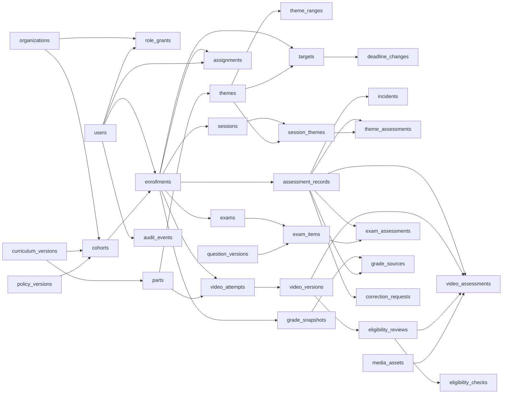
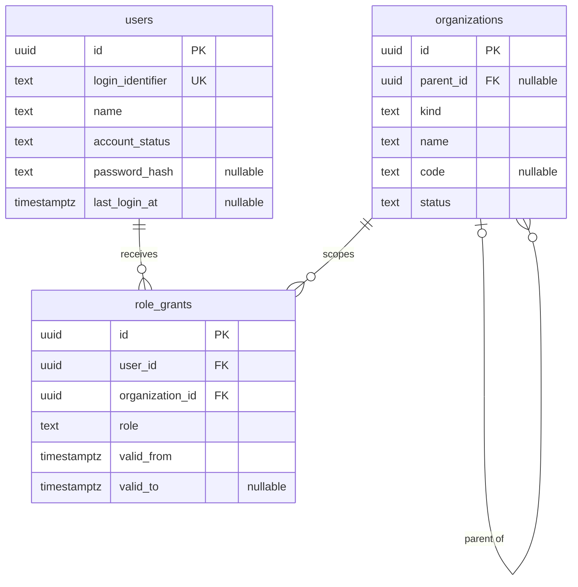
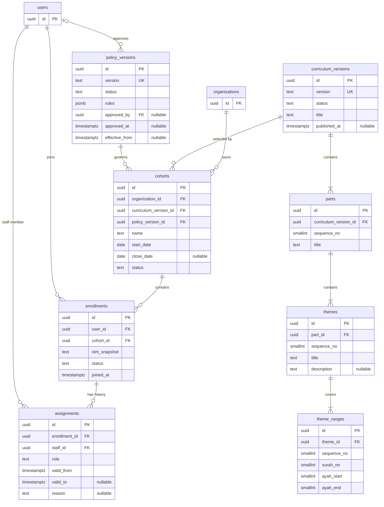
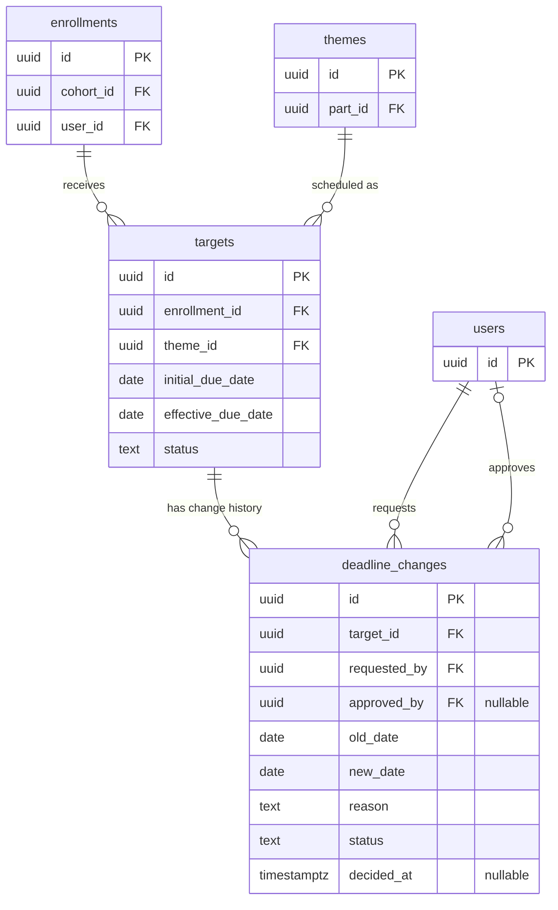
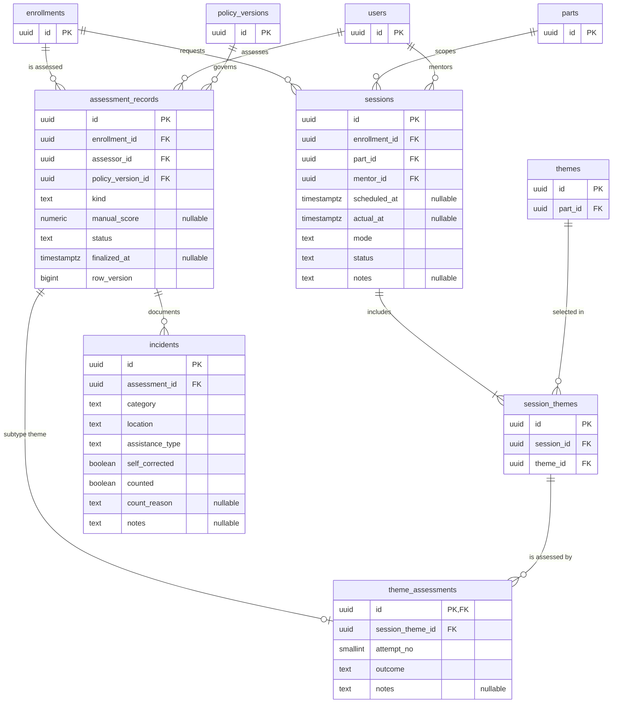
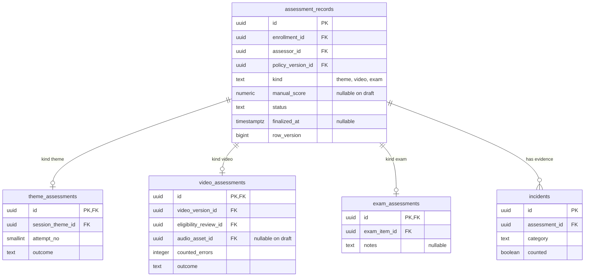
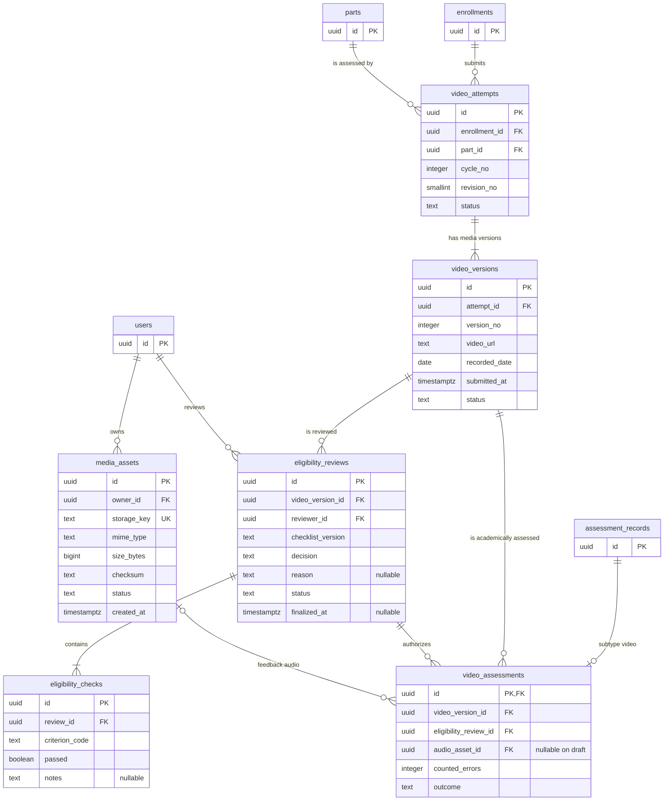
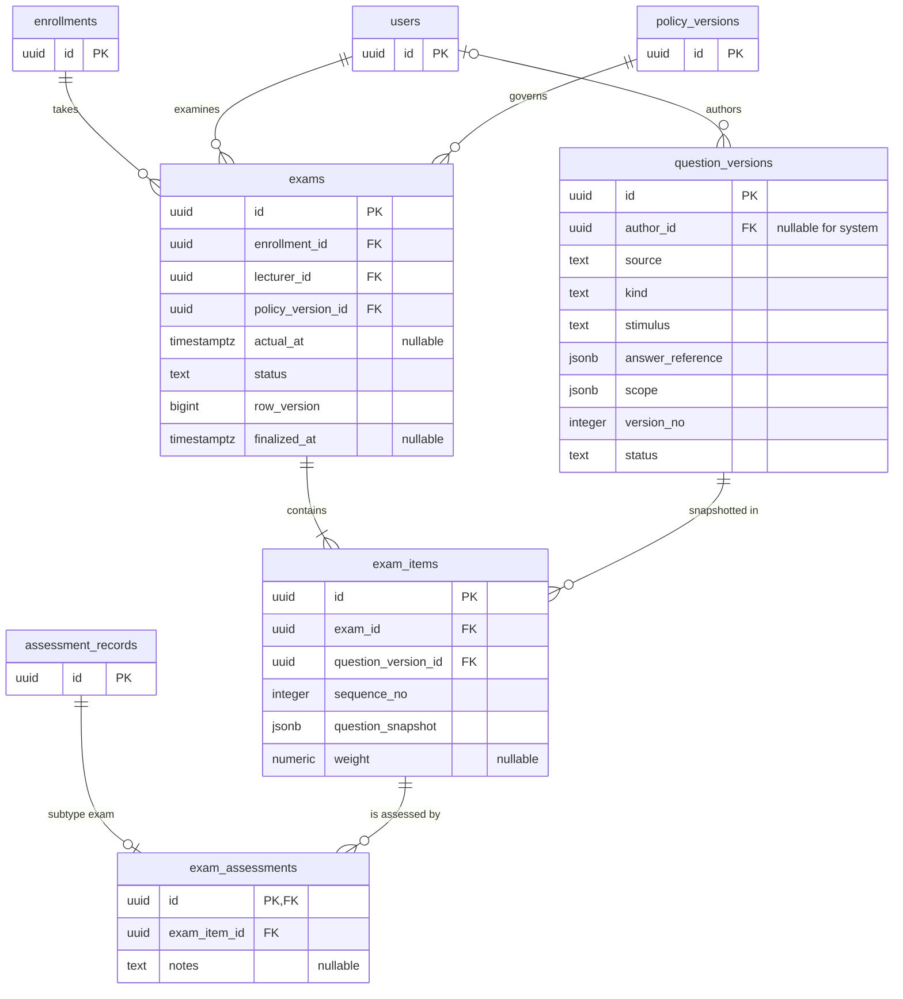
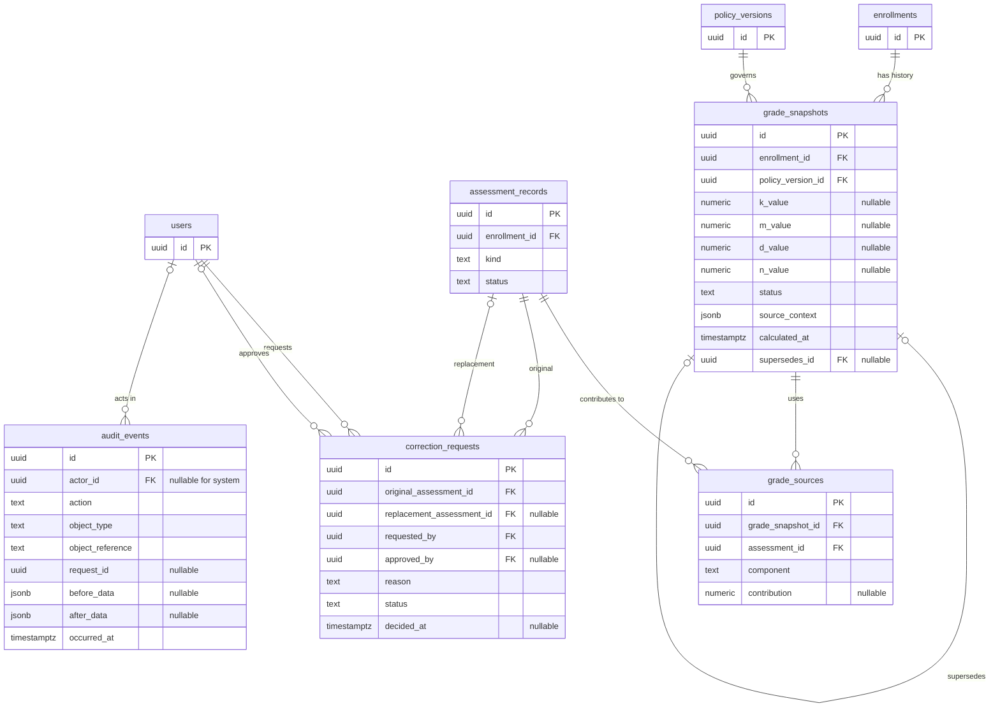
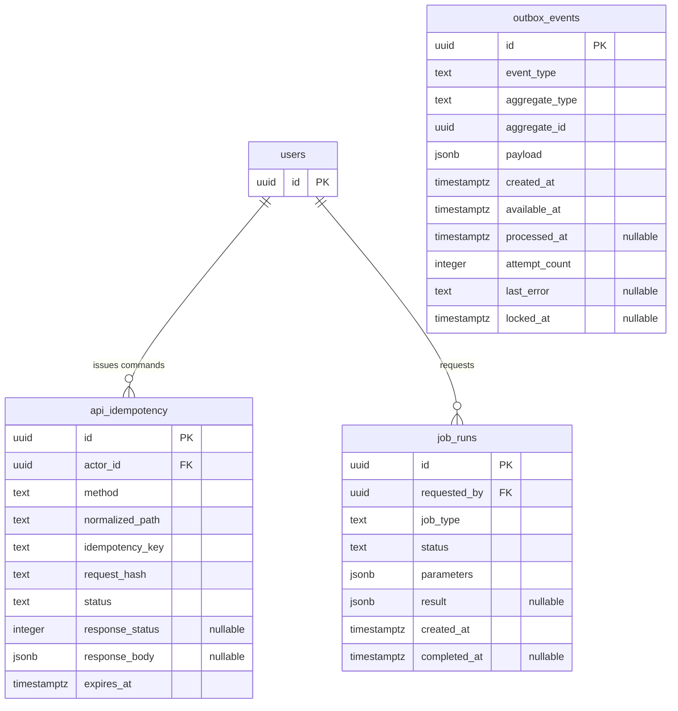

# Entity Relationship Diagram - YAQin

## Aplikasi Pendampingan Hafalan Juz 30

| Atribut | Nilai |
|---|---|
| Produk | YAQin - Yakin, Amalin, Mutqin |
| Dokumen | ERD logis dan relasi data |
| Versi | 1.0 |
| Tanggal | 20 Oktober 2026 |
| Status | Baseline implementasi untuk ditinjau |
| Database | PostgreSQL |
| Jumlah entitas domain | 32 |
| Dokumen terkait | `docs/database.md`, `docs/API.md`, `docs/Arsitektur.md`, `docs/PRD-Aplikasi-Tahfidz-YAQin.md` |

> Dokumen ini memvisualisasikan model relasional YAQin. Diagram dibagi per domain agar dapat dibaca dan dirender dengan baik. `docs/database.md` tetap menjadi kamus kolom dan constraint terperinci; migration SQL menjadi spesifikasi fisik yang dapat dieksekusi.

---

## 1. Tujuan dan Ruang Lingkup

ERD ini mencakup:

1. Identitas, organisasi, peran, angkatan, kepesertaan, dan penugasan.
2. Kebijakan, kurikulum, lima bagian, 44 tema, serta rentang ayat.
3. Target, tenggat, sesi pembimbingan, dan penilaian tema.
4. Siklus/revisi video, versi media, kelayakan teknis, penilaian akademik, dan audio.
5. Soal, ujian, penilaian Dosen, snapshot nilai, koreksi, dan audit.

ERD tidak memaksakan keputusan akademik yang belum disahkan, khususnya agregasi M, agregasi D, pembulatan, ujian ulang, dan detail alur koreksi lanjutan.

## 2. Notasi

| Notasi | Makna |
|---|---|
| `PK` | Primary key |
| `FK` | Foreign key |
| `UK` | Unique key atau bagian dari unique constraint |
| `||` | Tepat satu |
| `o|` | Nol atau satu |
| `|{` | Satu atau lebih |
| `o{` | Nol atau lebih |

Catatan:

- Semua primary key domain menggunakan UUID.
- Kolom `row_version` digunakan pada aggregate yang memerlukan optimistic concurrency.
- Timestamp disimpan sebagai `timestamptz`; tanggal tenggat memakai `date`.
- Diagram menampilkan kolom domain utama. Kolom standar seperti `created_at`, `created_by`, dan `updated_at` ditambahkan sesuai pedoman pada `database.md`.
- Relasi audit ke objek domain disimpan sebagai `object_type` dan `object_reference`, sehingga bukan foreign key fisik.

## 3. Peta Relasi Global

Diagram berikut menunjukkan alur relasi utama tanpa seluruh atribut.



## 4. ERD Identitas dan Organisasi



Aturan relasi:

- Fakultas berada pada akar dan jurusan memiliki tepat satu fakultas induk dalam cakupan sistem.
- Rantai `parent_id` tidak boleh bersiklus.
- Satu pengguna dapat memiliki beberapa peran dan beberapa lingkup organisasi, selama interval mandat sah.
- Role grant tidak sama dengan assignment. Role grant memberi kapasitas peran; assignment mengikat petugas pada peserta tertentu.

## 5. ERD Kebijakan, Kurikulum, dan Program



Constraint utama:

- `UNIQUE(users.id, cohorts.id)` diwujudkan sebagai `UNIQUE(user_id, cohort_id)` pada `enrollments`.
- `UNIQUE(curriculum_version_id, sequence_no)` pada `parts`.
- `parts.sequence_no` berada pada 1-5.
- `UNIQUE(part_id, sequence_no)` pada `themes`.
- `UNIQUE(theme_id, sequence_no)` pada `theme_ranges`.
- Versi kurikulum pilot yang diterbitkan harus memiliki 5 bagian dan total 44 tema dengan distribusi 10, 8, 6, 5, dan 15.
- Kurikulum dan kebijakan yang sudah digunakan tidak ditimpa; perubahan menghasilkan versi baru.
- Assignment lama tetap tersimpan ketika Mentor atau Dosen diganti.

## 6. ERD Kalender dan Tenggat



Aturan relasi:

- Satu peserta memiliki paling banyak satu target untuk satu tema: `UNIQUE(enrollment_id, theme_id)`.
- Tema target harus berasal dari versi kurikulum milik cohort peserta.
- `initial_due_date` tidak berubah.
- `effective_due_date` hanya berubah bersama approval `deadline_changes` dalam satu transaksi.
- Nilai lama, nilai baru, pemohon, penyetuju, dan alasan selalu dipertahankan.

## 7. ERD Pembimbingan dan Penilaian Tema



Aturan relasi:

- `UNIQUE(session_id, theme_id)` pada `session_themes`.
- Satu sesi memiliki minimal satu tema dan seluruh tema berada pada `sessions.part_id`.
- `actual_at`, bukan `scheduled_at`, menjadi kandidat tanggal setoran pertama.
- Nomor kesempatan dialokasikan server per peserta-tema pada rentang 1-5.
- Penilaian kelima yang belum Cukup menghasilkan `follow_up`; sistem tidak membuat kesempatan keenam.
- Koreksi membuat assessment pengganti dan tidak menaikkan `attempt_no`.

## 8. Pola Supertype Penilaian

Semua penilaian memiliki induk yang sama. Setiap `assessment_records` harus memiliki tepat satu subtype sesuai `kind`.



Mermaid hanya dapat menunjukkan bahwa setiap subtype opsional terhadap induk. Constraint tambahan wajib menjamin XOR berikut:

```text
count(theme_assessments, video_assessments, exam_assessments) = 1
assessment_records.kind = jenis subtype yang tersedia
```

Constraint tersebut diterapkan melalui service finalisasi transaksional dan deferred constraint trigger. Record final tidak diedit in-place.

## 9. ERD Video, Kelayakan, dan Media



Constraint utama:

- `UNIQUE(enrollment_id, part_id, cycle_no, revision_no)` pada `video_attempts`.
- `revision_no` berada pada 0-3; `cycle_no` dimulai dari 1.
- `UNIQUE(attempt_id, version_no)` pada `video_versions`.
- Penggantian teknis menambah `version_no`, bukan `revision_no`.
- `UNIQUE(review_id, criterion_code)` pada `eligibility_checks`.
- Review yang digunakan penilaian harus final, `eligible`, dan menunjuk versi video yang sama.
- `counted_errors` sama dengan jumlah `incidents.counted = true` pada assessment induk.
- Baseline kebijakan: 0-3 kesalahan menghasilkan `enough`, 4 atau lebih menghasilkan `not_enough`.
- Skor manual pada induk tidak mengubah status video.
- Audio boleh kosong pada draft, tetapi wajib berstatus `available` ketika final.

## 10. ERD Soal dan Ujian



Constraint utama:

- Ujian hanya dibuat untuk enrollment dengan lima bagian Cukup.
- Dosen memiliki assignment aktif kepada peserta.
- `UNIQUE(exam_id, sequence_no)` pada `exam_items`.
- `question_snapshot` tidak berubah jika bank soal mendapat versi baru.
- `answer_reference` dan snapshot acuan hanya dapat dibaca penguji berwenang.
- Bobot item tetap `NULL` sampai kebijakan bobot disahkan.
- Ujian final memiliki paket dan penilaian lengkap sesuai policy version.

## 11. ERD Nilai, Koreksi, dan Audit



Catatan penting:

- `supersedes_id` membentuk rantai snapshot yang tidak boleh bersiklus.
- `UNIQUE(grade_snapshot_id, assessment_id, component)` pada `grade_sources`.
- Sumber M/D hanya berasal dari assessment final, efektif, dan milik enrollment yang sama.
- Konteks K disimpan pada `grade_snapshots.source_context` karena bukan satu assessment tunggal.
- M dan D dapat `NULL`; N hanya dihitung bila K/M/D lengkap dan ujian final tersedia.
- Koreksi tidak mengubah hasil asli. `replacement_assessment_id` menunjuk record baru setelah koreksi diterapkan.
- Jika koreksi mencabut prasyarat, snapshot baru berstatus `needs_review`.
- `audit_events.object_reference` adalah relasi logis ke berbagai aggregate dan sengaja bukan FK polymorphic.

## 12. Daftar 32 Entitas Domain

| No | Entitas | Aggregate/domain | Parent utama |
|---:|---|---|---|
| 1 | `organizations` | Identitas | Self-reference opsional |
| 2 | `users` | Identitas | - |
| 3 | `role_grants` | Identitas | `users`, `organizations` |
| 4 | `policy_versions` | Kebijakan | `users` sebagai approver opsional |
| 5 | `curriculum_versions` | Kurikulum | - |
| 6 | `cohorts` | Program | `organizations`, versi kurikulum/kebijakan |
| 7 | `enrollments` | Program | `users`, `cohorts` |
| 8 | `assignments` | Program | `enrollments`, `users` |
| 9 | `parts` | Kurikulum | `curriculum_versions` |
| 10 | `themes` | Kurikulum | `parts` |
| 11 | `theme_ranges` | Kurikulum | `themes` |
| 12 | `targets` | Kalender | `enrollments`, `themes` |
| 13 | `deadline_changes` | Kalender | `targets`, `users` |
| 14 | `sessions` | Pembimbingan | `enrollments`, `parts`, `users` |
| 15 | `session_themes` | Pembimbingan | `sessions`, `themes` |
| 16 | `assessment_records` | Penilaian | `enrollments`, `users`, `policy_versions` |
| 17 | `incidents` | Penilaian | `assessment_records` |
| 18 | `theme_assessments` | Penilaian tema | `assessment_records`, `session_themes` |
| 19 | `video_attempts` | Video | `enrollments`, `parts` |
| 20 | `video_versions` | Video | `video_attempts` |
| 21 | `eligibility_reviews` | Video | `video_versions`, `users` |
| 22 | `eligibility_checks` | Video | `eligibility_reviews` |
| 23 | `media_assets` | Media | `users` |
| 24 | `video_assessments` | Penilaian video | `assessment_records`, video/review/media |
| 25 | `question_versions` | Ujian | `users` sebagai author opsional |
| 26 | `exams` | Ujian | `enrollments`, `users`, `policy_versions` |
| 27 | `exam_items` | Ujian | `exams`, `question_versions` |
| 28 | `exam_assessments` | Penilaian ujian | `assessment_records`, `exam_items` |
| 29 | `grade_snapshots` | Nilai | `enrollments`, `policy_versions`, self-reference |
| 30 | `grade_sources` | Nilai | `grade_snapshots`, `assessment_records` |
| 31 | `correction_requests` | Koreksi | assessment lama/baru, `users` |
| 32 | `audit_events` | Audit | `users`; objek memakai referensi logis |

## 13. Foreign Key dan Kebijakan Delete

Baseline PostgreSQL yang disarankan:

| Jenis relasi | `ON DELETE` | Alasan |
|---|---|---|
| Data master yang sudah dipakai | `RESTRICT` | Menjaga sejarah dan keterlacakan |
| User ke role/assignment/assessment | `RESTRICT` | Akun dinonaktifkan, bukan dihapus |
| Cohort ke enrollment | `RESTRICT` | Kepesertaan historis harus tetap ada |
| Curriculum ke part/theme/range | `RESTRICT` setelah publish | Versi terbit immutable |
| Session ke session theme | `RESTRICT` | Sesi historis tidak dihapus |
| Assessment ke subtype/incident | `RESTRICT` | Final record immutable |
| Video attempt ke version/review | `RESTRICT` | Versi media dan keputusan harus terlacak |
| Exam ke item/assessment | `RESTRICT` | Paket dan hasil ujian historis |
| Grade snapshot ke source | `RESTRICT` | Snapshot harus dapat direkonstruksi |
| Draft yang belum direferensikan | Diputuskan per use case | Lebih aman memakai status/cancel daripada hard delete |

Hard delete tidak digunakan untuk hasil final. Penonaktifan, `valid_to`, status, koreksi, dan supersession menjadi mekanisme utama.

## 14. Constraint Lintas Entitas

Constraint berikut tidak cukup diwakili oleh garis ERD dan wajib diterapkan pada domain service, transaksi, atau deferred trigger:

1. Tema target berasal dari curriculum version cohort peserta.
2. Bagian pada sesi dan video berasal dari curriculum version yang sama.
3. Seluruh tema dalam satu sesi berasal dari `sessions.part_id`.
4. Enrollment konsisten pada sesi, video, ujian, assessment, dan snapshot.
5. Assessor memiliki role grant serta assignment aktif pada waktu tindakan.
6. Satu `assessment_records` memiliki tepat satu subtype yang sesuai dengan `kind`.
7. Eligibility review untuk video assessment final, Layak, dan menunjuk video version yang sama.
8. Audio feedback final berstatus `available`.
9. `counted_errors` sama dengan jumlah incident terhitung.
10. Attempt tema dialokasikan per peserta-tema dan tidak lebih dari lima.
11. Siklus dan revisi video dialokasikan server dari hasil efektif.
12. Hanya hasil final dan efektif yang memperbarui progres.
13. Grade source final, efektif, dan milik enrollment snapshot yang sama.
14. Rantai correction dan supersession tidak bersiklus.
15. Kelulusan memerlukan lima bagian Cukup, ujian final, serta K/M/D lengkap.

## 15. Aggregate dan Batas Transaksi

| Aggregate | Root | Entitas yang berubah atomik |
|---|---|---|
| Penilaian tema | `assessment_records` | `theme_assessments`, `incidents`, progres terkait, audit, outbox |
| Kelayakan video | `eligibility_reviews` | `eligibility_checks`, status video, audit, outbox |
| Penilaian video | `assessment_records` | `video_assessments`, `incidents`, progres bagian, audit, outbox |
| Ujian | `exams` | `exam_items`, `assessment_records`, `exam_assessments`, snapshot bila siap, audit, outbox |
| Tenggat | `deadline_changes` | `targets.effective_due_date`, audit, outbox |
| Nilai | `grade_snapshots` | `grade_sources`, source context, audit, outbox |
| Koreksi | `correction_requests` | replacement assessment, status lama, progres/snapshot terdampak, audit, outbox |

Row lock disarankan pada:

- peserta-tema saat mengalokasikan `attempt_no`;
- peserta-bagian saat mengalokasikan `cycle_no` dan `revision_no`;
- ujian saat finalisasi;
- peserta saat menerbitkan snapshot nilai.

## 16. Tabel Teknis di Luar 32 Entitas Domain

Arsitektur menggunakan beberapa tabel operasional. Tabel ini bukan bagian dari ERD domain sumber, tetapi diperlukan untuk keandalan implementasi.



`outbox_events.aggregate_id` adalah referensi logis karena event dapat berasal dari berbagai aggregate. Event dibuat pada transaksi yang sama dengan perubahan domain.

## 17. Urutan Migration yang Disarankan

1. Extension UUID dan schema `app`, `ops`, serta `alembic` bila digunakan.
2. `organizations`, `users`.
3. `role_grants`, `policy_versions`, `curriculum_versions`.
4. `cohorts`, `enrollments`, `assignments`.
5. `parts`, `themes`, `theme_ranges`.
6. `targets`, `deadline_changes`.
7. `sessions`, `session_themes`.
8. `assessment_records`, lalu `incidents`.
9. `theme_assessments`.
10. `video_attempts`, `video_versions`, `eligibility_reviews`, `eligibility_checks`, `media_assets`, `video_assessments`.
11. `question_versions`, `exams`, `exam_items`, `exam_assessments`.
12. `grade_snapshots`, `grade_sources`.
13. `correction_requests`, `audit_events`.
14. Tabel teknis `api_idempotency`, `outbox_events`, dan `job_runs`.
15. Deferred constraint trigger, partial unique index, view, dan seed data.

## 18. Indeks Relasi Utama

Selain indeks otomatis pada PK dan unique constraint:

| Entitas | Indeks |
|---|---|
| `role_grants` | `(user_id, role, organization_id, valid_to)` |
| `enrollments` | `(cohort_id, status)` |
| `assignments` | `(enrollment_id, role, valid_to)` |
| `targets` | `(enrollment_id, effective_due_date, status)` |
| `sessions` | `(mentor_id, scheduled_at, status)`, `(enrollment_id, actual_at)` |
| `assessment_records` | `(enrollment_id, kind, status, finalized_at)` |
| `incidents` | `(assessment_id, counted)` |
| `video_attempts` | `(enrollment_id, part_id, status)` |
| `video_versions` | `(attempt_id, version_no DESC)` |
| `eligibility_reviews` | `(video_version_id, status, finalized_at)` |
| `exams` | `(lecturer_id, status, actual_at)` |
| `grade_snapshots` | `(enrollment_id, calculated_at DESC)` |
| `correction_requests` | `(original_assessment_id, status)` |
| `audit_events` | `(object_type, object_reference, occurred_at DESC)` |

## 19. Validasi ERD

ERD dianggap konsisten jika pengujian berikut lulus:

- Seluruh foreign key menunjuk record yang valid.
- Tidak ada organisasi, correction chain, atau snapshot chain yang bersiklus.
- Target tidak dapat memakai tema dari curriculum version lain.
- Sesi tidak dapat berisi tema lintas bagian.
- Tepat satu subtype tersedia untuk setiap assessment.
- Peserta pada assessment sama dengan peserta pada objek akademik.
- Eligibility review dan video assessment menunjuk video version yang sama.
- Attempt tema tidak ganda pada request bersamaan.
- Revisi akademik video tidak berubah karena penggantian teknis.
- Snapshot nilai hanya memakai assessment final dan efektif.
- Record final, snapshot, dan versi kebijakan lama tidak ditimpa.
- Audit tidak menyimpan secret atau isi media.

## 20. Definition of Done ERD

ERD siap diturunkan menjadi migration ketika:

- Seluruh 32 entitas, PK, FK, cardinality, dan self-reference telah ditinjau.
- Constraint lintas tabel memiliki lokasi implementasi yang jelas.
- Delete policy dan retensi data telah disahkan.
- Enum/status telah dipetakan ke check constraint atau reference table.
- Partial unique index untuk mandat/assignment aktif telah dirancang.
- Deferred trigger untuk subtype assessment dan rantai historis telah diuji.
- Keputusan akademik yang masih terbuka tidak memiliki default tersembunyi.
- Migration dapat dijalankan dari database kosong dan di-rollback sesuai kebijakan.
- Seed data kurikulum dan policy version tervalidasi.
- Diagram, kamus database, API, dan model ORM menggunakan nama yang konsisten.

---

Dokumen ini adalah representasi logis. Implementasi fisik final harus diverifikasi melalui migration PostgreSQL, constraint test, dan pemeriksaan bahwa OpenAPI tidak mengekspos field privat atau relasi di luar lingkup pengguna.
